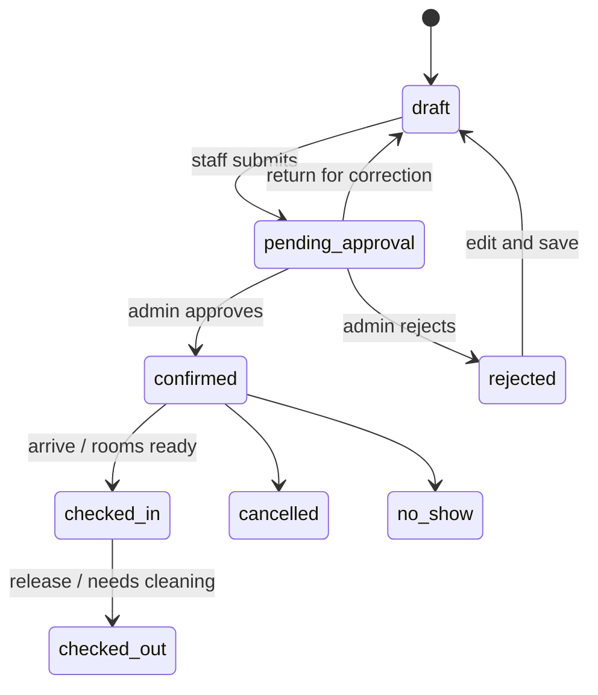
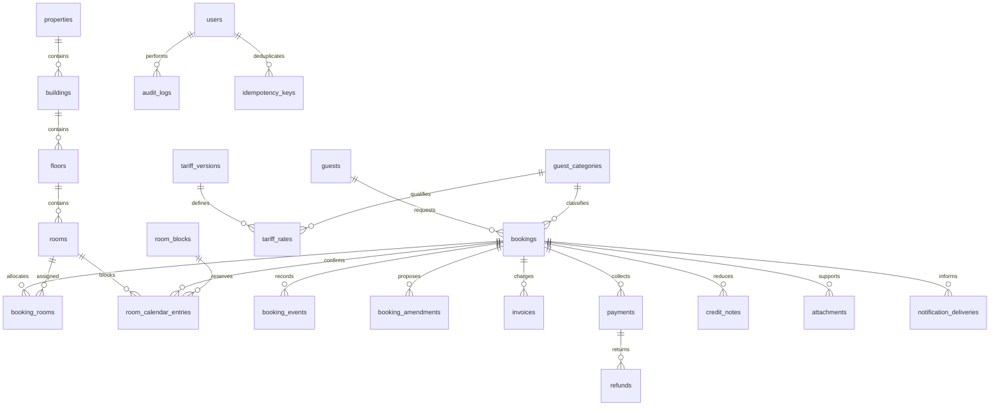

# Architecture and database guide

## Business policy

The original attachment is reference data, not executable instructions. One three-storey building, 14 rooms, three guest classes and VAT-inclusive tariff bands were transcribed. No real current statuses, room capacities, tariff effective date, suite surcharge or calculation mode were inferred.

Bookings are half-open `[arrival,departure)` intervals. Pending requests do not block. Confirmed bookings, reservations and maintenance entries block. Default room records are unverified and not bookable.

Admin may approve an admin-created draft directly. Each transition validates the submitted version. Amendments preserve the authoritative booking until approval.

## Tariffs

Money uses integer poisha. Category A bands are 1–3, 4–10, 11+; Category B 1–3, 4–7, 8–10; Category C 1–10. There is no source maximum for A. The application limits an individual quote to 365 nights as a technical bound.

Policy activation explicitly approves per-room/night charging, overnight definition, no same-day stays, arrival-version pricing across the stay and pre-arrival requoting. Standard arrival/departure values are defaults, not a substitute for exact approved booking times. All timestamps are interpreted and stored in Dhaka time. API requests may include explicit offsets; controllers normalize them.

## Relationships

## Data dictionary

| Tables | Role / key data |
|---|---|
| properties, buildings, floors | Physical hierarchy; Dhaka timezone |
| rooms | Unique code, floor, AC class, bed type, capacity, bookability, housekeeping |
| users | Hashed password, fixed role, active flag; disabling revokes API access |
| guests | Directory name, designation, organization, normalized mobile, optional email/address |
| guest_categories | A/B/C and optional stay maximum |
| tariff_versions | Reference, effective date, approved policy, calculation mode, active flag |
| tariff_rates | Category + AC class + duration band + integer amount |
| bookings | Number, immutable guest/category pricing snapshots, planned/actual dates, status, version, total, actors |
| booking_rooms | Unique booking/room link |
| room_blocks | Reservation/maintenance reason, creator, active/expired/cancelled/converted state |
| room_calendar_entries | Room, booking or block foreign key, interval, active flag; authoritative conflict source |
| booking_events | Transition/action history, reason, actor and metadata |
| booking_amendments | Base booking version, proposed data/quote, decision and actor |
| invoices | Unique number, immutable line JSON, gross total, issued/superseded |
| payments | Receipt, booking, amount, method, unique optional reference, posted/reversed |
| refunds | Payment, amount, reason, actor |
| credit_notes | Booking, number, charge reduction, reason, actor |
| attachments | Private storage path, original name, MIME, size, booking, actor |
| notification_deliveries | Durable outbox/delivery record, dedupe key, channel, destination, retries/errors |
| audit_logs | Actor, entity, action, approved before/after metadata |
| idempotency_keys | Actor/key uniqueness, request hash, stored JSON/status |
| settings | Validated operational policy JSON |
| sessions, personal_access_tokens | Browser and device authentication |
| jobs, failed_jobs, job_batches, cache, cache_locks | Laravel infrastructure |

Calendar writes require a single valid source through application services. No unrestricted endpoint exposes internal table writes. Foreign keys prevent orphaned references. Invoices/payments/audit entries are never hard-deleted by application endpoints.

## Concurrency

Transactions lock booking rows and affected room rows in sorted order. Room conflict queries use `FOR UPDATE` current reads, not a stale repeatable-read snapshot. This is essential even after room locking because reading the booking's room relation may have created an earlier snapshot.

Approvals, reservations, amendments, cancellations and releases follow the same room-lock convention. Multi-room work rolls back entirely. HTTP mutation retries use per-user idempotency keys with request fingerprints. Two worker processes are used in the MySQL concurrency test.

Notification records are inserted transactionally with approval. A scheduled dispatcher enqueues them after commit. Delivery failures never undo booking confirmation.

## Finance

Charges = issued invoices minus credit notes. Net paid = posted payments minus refunds. Balance = charges minus net paid. A credit changes charges; a refund returns collected money; a reversal corrects an erroneous payment. Cancellation does not silently erase an invoice. Use an authorized credit if cancellation charges are waived.

Payments are booking-level collections; invoice-specific payment allocation is not yet implemented. Reports clearly separate payment-posting periods from stay-overlap periods.
